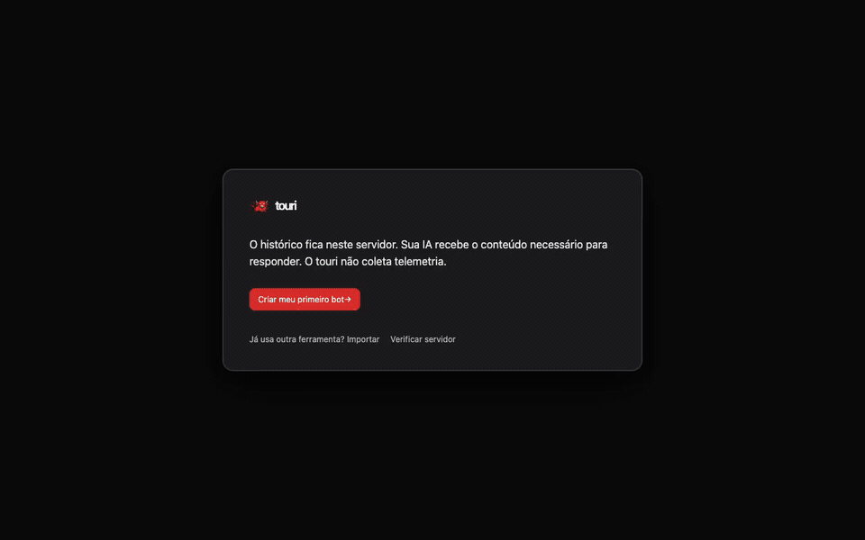

<p align="center">
  
</p>

# touri desktop

touri is a local-first desktop app for macOS and Linux for running persistent AI teammates ("bots") on your own
Codex, Claude Code or OpenCode CLI. Everything runs on your computer: your conversations, memory, routines
and secrets never leave the machine unless you explicitly configure a remote.

Built with Tauri v2 (Rust shell), a Bun sidecar and a React UI.

<p align="center">
  
</p>

## Features

- Persistent bots with their own instructions, memory, skills and full branching chat history.
- Codex and Claude Code runtimes, with approval modes (`on-request`, `workspace-write`, `full`).
- Routines: cron-scheduled bot runs with overlap and catch-up control.
- Projects: connect a local repo, run supervised processes (databases, servers) and preview them in-app.
- Agent browser with human take-over, and opt-in computer use with a visible indicator and kill switch.
- MCP gateway with per-thread tokens and approval prompts.
- Bot machines: Apple `container` on macOS; rootless Podman or Docker containers on Linux.
- Importer for data exported by an earlier setup (see below).

## Privacy

- Local-first: data lives in SQLite in the OS application data directory.
- No telemetry and no account required.
- Desktop credentials use macOS Keychain or Linux Secret Service, never the database, logs or exports.
- Optional cloud hosting is a separate, opt-in protocol (`docs/protocol/cloud-v1.md`).

## Platforms

- macOS (Apple Silicon): supported, macOS 14 or newer.
- Linux (x86_64/arm64): supported. Packages and desktop onboarding have been tested on x86_64;
  the arm64 sidecar is cross-built, with native arm64 packaging/runtime validation still pending.
- Windows: port in progress; see the [platform runbook](docs/runbooks/platforms.md).

## Install (GitHub Releases)

For macOS, download the [v0.1.0 disk image](https://github.com/touri-ai/touri/releases/download/v0.1.0/touri_0.1.0_aarch64.dmg) and drag `touri.app` to `/Applications`.
The v0.2.0 prerelease provides Linux packages; the macOS download remains v0.1.0.
Release builds are currently unsigned and not notarized, so macOS Gatekeeper blocks the first launch:

1. Open `touri.app`. macOS shows a warning and refuses to open it.
2. Open System Settings > Privacy & Security, scroll to the message about touri and click "Open Anyway".
3. Confirm with your password. Later launches open normally.

On macOS 15 and later, Control-click > Open no longer bypasses Gatekeeper, so use the steps above.

Or remove the quarantine flag from a terminal:

```sh
xattr -dr com.apple.quarantine /Applications/touri.app
```

### Linux install

Download the [Linux x86_64 AppImage](https://github.com/touri-ai/touri/releases/download/v0.2.0/touri_0.2.0_amd64.AppImage) or use the Debian package below. With the AppImage:

```sh
chmod +x touri_0.2.0_amd64.AppImage
./touri_0.2.0_amd64.AppImage
```

On Debian 13 x86_64 (or a compatible desktop with glibc 2.39 or newer), download [touri 0.2.0 (.deb)](https://github.com/touri-ai/touri/releases/download/v0.2.0/touri_0.2.0_amd64.deb),
then run this command in the download folder:

```sh
sudo apt install ./touri_0.2.0_amd64.deb
```

SHA-256 for `touri_0.2.0_amd64.deb`:

```text
2db31d0292ea0aee052fe988cda9a5313b3621731089807dbf70956a1bd53005
```

This package was built on Debian 13 x86_64. Checksums for all Linux assets are also in
[SHA256SUMS](https://github.com/touri-ai/touri/releases/download/v0.2.0/SHA256SUMS).

Linux needs WebKitGTK 4.1, SQLite, xdg-utils, and a session D-Bus with libsecret and an
unlocked Secret Service keyring, such as GNOME Keyring or KWallet with its Secret Service
interface enabled. Credentials use that service; a missing or locked keyring is reported
by doctor and never causes plaintext credential storage. AppImages also need FUSE, or
`APPIMAGE_EXTRACT_AND_RUN=1` on hosts without FUSE.

Desktop data lives in `$XDG_DATA_HOME/touri` (default `~/.local/share/touri`).
The standalone headless server retains `~/.touri`; `TOURI_APP_DATA` overrides either location.
Podman or Docker is optional for VM bots. If no working container engine is available,
local bots remain available and the machine feature reports why it cannot start.

Host computer use is hidden on Linux. Local browser automation needs an installed
Chromium/Chrome or `TOURI_CHROME_BIN`. Interactive provider onboarding currently uses
credential import. Linux OCI lifecycle/isolation contracts are tested, but live container
onboarding could not be verified on the build host because it denies user namespaces.

## Requirements

- macOS 14 or newer on Apple Silicon. The optional bot-machine feature needs macOS 26 and Apple `container` >= 1.5.0;
  on older systems local bots keep working and the machine feature reports itself as unavailable.
- Bun 1.4.3 or newer
- Rust 1.90 or newer with the `aarch64-apple-darwin` target
- A Codex or Claude Code CLI signed in on your Mac

Linux build instructions and the Windows port status: [platform runbook](docs/runbooks/platforms.md).

## Build from source

```sh
bun install
bun run build:sidecar
bun run tauri build --bundles app
open src-tauri/target/release/bundle/macos/touri.app
```

For local rebuilds that retain saved logins, use [stable macOS signing](docs/runbooks/macos-vault.md) and `scripts/build-macos-signed.sh`.
Signing, notarization and the updater are wired but disabled (`docs/DECISIONS.md`).
For development: `bun run build:sidecar && TOURI_SIDECAR_BIN="$PWD/src-tauri/binaries/touri-sidecar-aarch64-apple-darwin" bun run tauri dev`.

### Build from source on Linux

Install Bun 1.4.3+ and Rust 1.90+. On Debian/Ubuntu, install the system dependencies:

```sh
sudo apt install build-essential pkg-config libssl-dev libgtk-3-dev \
  libwebkit2gtk-4.1-dev libayatana-appindicator3-dev librsvg2-dev \
  libdbus-1-dev libsecret-1-0 gnome-keyring libsqlite3-0 patchelf xdg-utils unzip
bun install --frozen-lockfile
bun run build:sidecar:linux
bun run tauri build --bundles appimage,deb
```

Bundles are written to `src-tauri/target/release/bundle/{appimage,deb}`.
On an arm64 Linux host, use `bun run build:sidecar:linux:arm64` before the same Tauri build.
GTK/WebKit development libraries must match the shell's architecture. Full platform
requirements, container setup and account-free checks are in the [runbook](docs/runbooks/platforms.md).

## Verify

```sh
bun run typecheck
bun run lint
TOURI_BROWSER_HEADLESS=1 bun test sidecar/test
(cd ui && bunx vitest run && bunx vite build && bunx playwright test)
(cd src-tauri && cargo test && cargo clippy --all-targets -- -D warnings)
```

Opt-in real CLI smoke: `TOURI_E2E_REAL_CLI=1 bun test sidecar/test/runtime/real-cli.test.ts`.

## Import from a previous setup (dry run)

The importer reads the data directory of an earlier bot setup, from a local path or over SSH,
and maps bots, chats, memory, skills and routines into touri. It is idempotent, imports routines
disabled, and never reads credential files.

```sh
TOURI_APP_DATA="$HOME/Library/Application Support/touri-dev" \
  bun sidecar/src/importer/legacy/cli.ts --source ssh --host user@host.example \
  --root '~/.legacy-app' --dry-run --all
```

The SSH source is read-only on the remote (allowlisted files only, no remote writes).
Drop `--dry-run` to import, `--bot <name>` selects bots, `--cwd-map <from>=<to>` maps paths.

## Run the sidecar directly

```sh
TOURI_UI_TOKEN=dev-ui-token bun run sidecar/src/main.ts serve
```

It prints one `SidecarHandshake` JSON line to stdout. The MCP stdio mode is a byte
pipe for a running sidecar and reads only the per-thread token file; it does not open
SQLite:

```sh
bun run sidecar/src/main.ts mcp-stdio --thread <thread-id>
```

## Repository rules

`packages/contracts/` holds the shared types, SQL schema and MCP tool schema; changes
there require a contract change before dependent work merges. Credentials are never
imported or stored in SQLite. See `CONTRIBUTING.md`, `SECURITY.md`, `NOTICE` and
`TRADEMARKS.md`.

## License

Apache-2.0, see `LICENSE`. Third-party notices: `THIRD_PARTY_NOTICES`.

