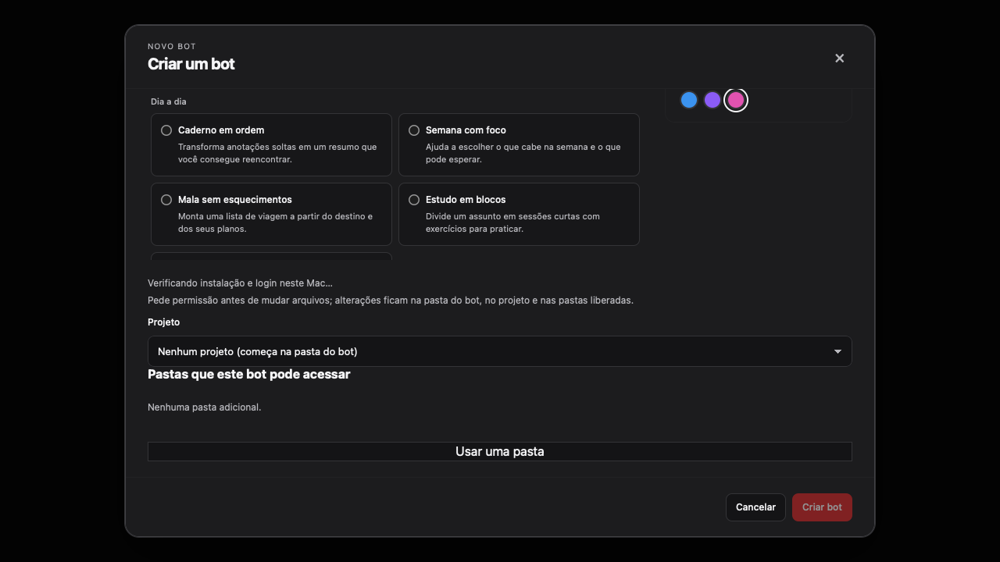

# Native QA round 7 evidence

Issue #252 covers account discovery, separate-computer deletion and restart waiting states.

The new regressions failed before the fixes: the selected account inherited another check's error, the destructive checkbox overflowed at 800×600 and 962×642, startup switched to the generic reply-delay notice, and sequential guest writes could not satisfy the setup concurrency barrier.

The browser checks render the production components and verify text geometry, the unchecked files option, reachable actions, account loading and startup copy. Images below show the affected controls. Full viewport captures are produced by the same checks.

## Timing experiment

Measured on the same Mac using a disposable app-data directory, a newly created test bot, its own volumes and a temporary connection key. The installed app's data was never opened. A host login was read and staged privately for the test bot; provider state remained in its disposable guest. A short prompt requested a single word and no tools, with the same default model and low reasoning setting in both runs. Advancing the runtime's idle clock triggered the normal inactivity stop. The computer was then reopened before the resumed prompt, matching QA's sequence.

The JSONL files contain only relative timings and protocol stage names. They exclude identifiers, credentials, account information, prompts and filesystem paths. `ms` is each operation's duration; `at`, when present, is elapsed time since the experiment started. `response-1`, `response-2` and `response-3` correspond to provider initialization, session start/resume and turn start. Tool startup status frames delimit connection setup; their payloads are intentionally omitted. `runtime.*` rows in the after log are the existing stage logger's duration summaries.

| After inactivity | Before | After |
| --- | ---: | ---: |
| Computer start command | 2,694 ms | 3,118 ms |
| Reopen through computer readiness | 6,118 ms | 4,282 ms |
| Message preparation after reopening | 3,762 ms | 1,435 ms |
| Provider initialization response | 545 ms | 477 ms |
| Session resume response | 734 ms | 653 ms |
| Last tool startup status | 1,566 ms | 1,223 ms |
| First text after provider invocation | 3,281 ms | 3,360 ms |
| Total from send to first text | 7,043 ms | 4,795 ms |

[Before timing log](before-timing.jsonl) · [After timing log](after-timing.jsonl)

These are individual samples, not a benchmark or a promise of a fixed speedup. Host process startup and remote response time vary. The regression test deterministically proves the eliminated serialization: token writing, instruction writing and bridge startup must all begin before either write can finish. The provider still starts only after preparation completes, and existing cancellation and credential cleanup checks remain in place.

The original 57-second response did not recur. These measurements cannot assign its historical cause or establish that all long waits are eliminated. They separate boot, preparation, provider startup and tool connection in the reproduced sequence. While the computer is being prepared, the UI now says “Ligando o computador do bot…” / “Starting the bot’s computer…”; its reply-delay notice starts counting when the provider is invoked.

VISION promises served: explicit control (#4), usable isolation (#6), calm and clear native interaction (#7).

## Validation

- `bun install --frozen-lockfile`: installed the worktree's own dependencies.
- `bunx biome check .` and `bun run typecheck`: passed.
- `NODE_OPTIONS=--no-experimental-webstorage bunx vitest run` from `ui`: 137 files, 1,494 tests passed.
- `TOURI_VM_INTEGRATION=0 bun test sidecar/test/vm/<file>`, one file per process: all 43 files passed, with 388 tests passed and 18 skipped. The base commit `7f4a3bd` passed the same file-by-file comparison with 387 passed and 18 skipped; the additional test is the setup concurrency regression. An earlier aggregate attempt encountered `SQLITE_FULL` / `ENOSPC`; it was replaced by this isolated replay.
- `bun --cwd ui build`: passed; initial bundle gzip size 337.08 kB.
- `TOURI_E2E_PORT=15381 bunx playwright test --config playwright.native-r7.config.ts` from `ui`: 8 checks passed across both configured engines, including 800×600 and 962×642.
