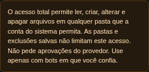

# Full local access

Synthetic local bot with full access, provider approvals disabled, and a saved read-only folder. The same browser regressions run against main (`1d026e1`) fail at both widths because its warning claims that saved folder restrictions still limit full access. With this change, both pass. Switching to restricted access restores the folder explanation without saving settings automatically.

Captures show only the access warning from the running UI. They contain no production data.

| Width | Before | After |
| --- | --- | --- |
| 390 px |  |  |
| 1440 px |  |  |

Browser evidence: `ui/test/e2e/full-local-access.spec.ts`, executed through the queued test gate with one worker: main **2 failed**, changed UI **2 passed**. Both runs use the same synthetic fixture and assertions.

Related regressions cover existing write access to the working directory, bot home and project, missing output directories, stale grants, unchanged configuration and continuation counts, approval policy, and isolated execution. See `sidecar/test/projects/setup-tools.test.ts`, `sidecar/test/runtime/folder-access.test.ts`, `sidecar/test/runtime/instructions.test.ts`, `ui/test/bot-folders.test.tsx`, and `ui/test/data-access-copy.test.ts`.

VISION promises 4 and 7: the person can understand the access they selected, in Portuguese and English, without a redundant permission loop.

The disposable server smoke used a real local provider and completed four messages: a direct write, both redundant setup tools plus another write, a write after inserting a legacy read-only grant, and a later greeting. Both setup tools returned `alreadyAccessible`; no folder or project was added. The legacy grant stayed saved while writing and conversation still succeeded. Three files contained their exact synthetic values. The server and its temporary data were then removed.

The smoke and production UI build ran as two sequential checks inside the sanctioned gate: **2 pass / 0 fail**. The build transformed 1,087 modules and completed in 17.52 seconds. [Sanitized results](live-smoke.json).
