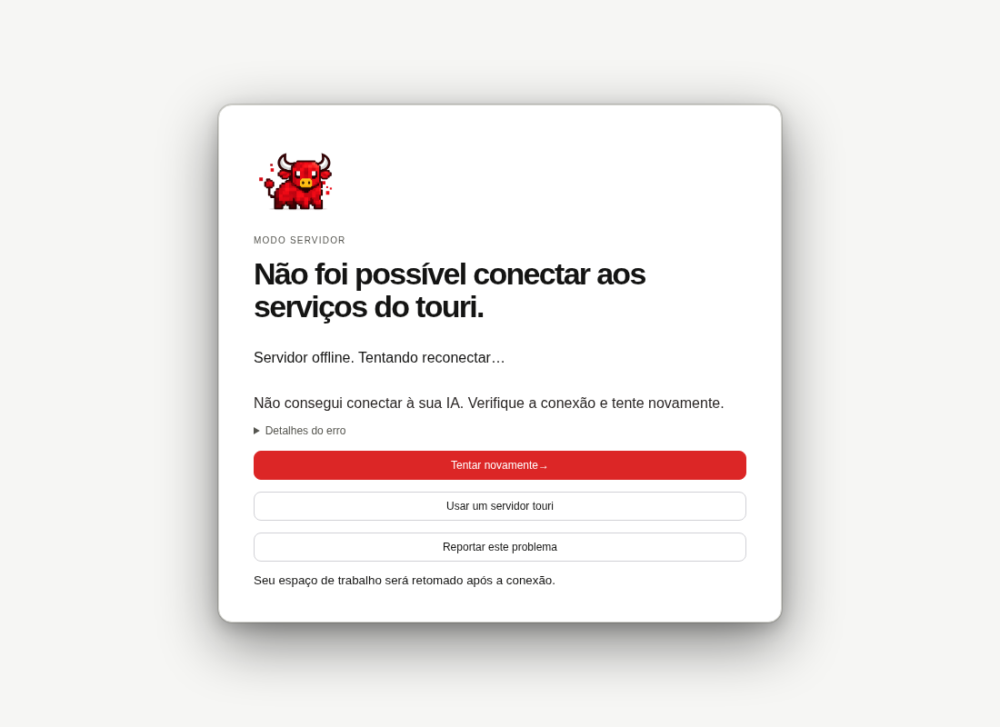

# Server startup recovery

A paired desktop whose first endpoint or health request stalls shows the offline recovery screen after the 20-second startup deadline:

The server-mode browser test holds the first health response, waits for this screen, releases the late response and verifies that it cannot restore the workspace. It then allows fresh requests and checks that the conversation becomes available automatically, without clicking retry or restarting a local sidecar. Later assertions cover live events, resync after a replay gap over 2 MiB and returning to local mode.

The fixture builds the production UI and uses a disposable touri server with real pairing, REST and event traffic. Native IPC is substituted. The bot and workspace data are synthetic; native vault/TLS and macOS memory measurements remain manual checks in the server-mode runbook.

The serialized gate passes type checking, formatting/lint and all 63 selected UI test files. Three regression cases fail on the earlier PR implementation and pass after the retry fix; all 13 recovery tests pass. The targeted server-mode browser test passes in 1.7 minutes, including the production build.

VISION promises #3, #6 and #7: automatic workspace recovery, explicit server selection and clear connection state.
