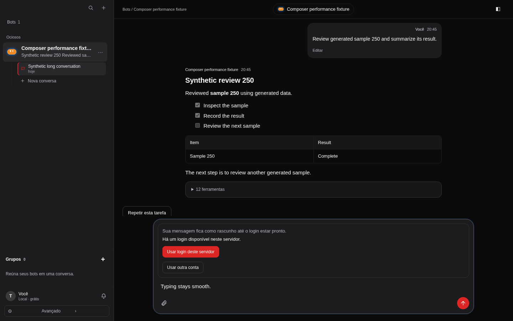

Typing used to update the durable draft in `ChatPanel`. Each edit rebuilt the active message path and
rendered the visible transcript, including Markdown, tool cards and scroll effects. Existing message
windowing limited the number of messages rendered, but did not isolate them from composer edits.

The draft and task-resume handling now live in a keyed `DraftComposer`. Suggested prompts fill it
through a narrow ref. The existing durable draft hook and send semantics are preserved. Native
textarea sizing avoids repeated forced layout where supported; older webviews retain their measured
fallback. Closed historical tool groups defer mounting their cards until first expansion, then keep
the same cards and disclosure state. Pending approvals stay visible and actionable.

The browser fixture starts a separate paired server with a new temporary database containing **500
generated messages and 3,000 settled tool calls**. It does not read existing conversations or launch
a model turn. It uses the real App and HTTP client, a production profiling build, headless Chromium,
a 1440 × 900 viewport and 4× CPU throttling. After warming focus and autosize, it types 20 real keys.

Preserved measurements from before the interruption:

| Measurement | Baseline (`1d026e1`) | Draft isolation only |
| --- | ---: | ---: |
| p95 keydown → input microtask | 3,054.3 ms | 29.6 ms |
| p95 keydown → next animation frame | 3,500.8 ms | 39.1 ms |
| p95 keydown → task after animation frame | 4,390.3 ms | 56.5 ms |
| React commits while typing | 123 | 42 |
| p95 React render duration | 805.2 ms | 1.6 ms |
| Transcript list renders | 60 | 0 |
| Markdown renders | 1,980 | 0 |
| Tool-list renders | 1,980 | 0 |
| Mean main-thread work per key | 4,295.2 ms | 85.3 ms |
| p95 main-thread work per key | 4,794.2 ms | 111.8 ms |
| Initial navigation → latest reply ready | 16,807.7 ms | 20,426.9 ms |

**These are not passing measurements of the final revision.** The draft-only run failed the 16 ms
input-processing budget; initial loading also exceeded the 15 s budget. Native textarea sizing and
deferred tool-card mounting were added afterward to address those remaining costs. Their performance
and behavior still require measurement in CI/review. The box owner paused every check during recovery;
the gate reports `skipped` with exit 0, which is **not a pass**. No check bypassed that pause.

The gate's earlier baseline component test failed as intended: three edits caused **102 Markdown
renders**, with 694 other cases passing. The subsequent affected UI run was interrupted and has no
complete passing result. An earlier browser run completed the regular UI production build, but that
also predates the final sizing and mounting changes. Earlier formatting checks passed; the latest
attempt at typechecking was interrupted by a gate script error. Final typecheck, formatting, UI tests,
build and browser budgets must run in CI/review.

The dedicated CI job keeps the budget at **zero transcript/Markdown/tool-list renders per edit**, p95
input processing **<16 ms**, p95 next frame **<50 ms**, and initial loading **<15 s**. The frame budget
allows refresh alignment and a throttled CI CPU; the render-count assertions catch the regression
without relying on timing. Browser coverage also checks multiline growth, scrolling at the height
cap and shrinking after clearing. Unit coverage checks incoming replies, prompt fill/focus, recovery,
and lazy tool expansion with preserved disclosure and approval focus.

`requestAnimationFrame` marks a frame opportunity, not physical display latency. The following task
offers a paint opportunity, but is not a direct paint timestamp. Main-thread totals include browser
automation, measurement and background tasks. Initial loading includes navigation, assets and fonts.
The measurements cover settled history and single-line typing, not simultaneous streaming. Closed
historical tool bodies become available to browser text search when first expanded.

Numeric samples: [baseline](composer-before.json), [draft isolation](composer-draft-isolation.json).
Only generated measurements and inspected synthetic screenshots are published; raw traces remain
local because they contain machine-local source paths. CI uploads only the numeric report and PNG.

| Baseline | Draft isolation only (before final sizing and mounting changes) |
| --- | --- |
|  |  |

On this development box, checks must go through the owner's `touri-test.sh` gate. Once resumed, run
`touri-test.sh typecheck biome vitest e2e` from the worktree. The browser case performs the regular UI
production build before making a separate profiling build and deletes its temporary server data on
completion. The dedicated CI job runs the same browser case with one worker and no real credentials.

This serves VISION promises **7** (fast, calm, readable UI) and **3** (preserved drafts and history).
