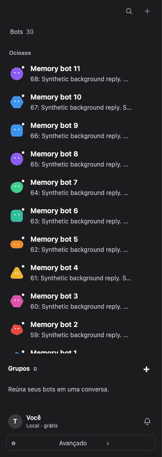

Server mode previously retained every live message from every bot, including complete output, and
kept every conversation visited during the session. The initial activity endpoint was already compact;
live delivery bypassed that boundary. Loading a transcript also buffered an unlimited number of
intervening stream patches. These paths allowed an idle desktop to grow while other clients worked.

The client now retains the selected conversation's transcript and compact background activity:
512-character previews, current status and approval/notice parts. It keeps the same five latest-message
categories as the server projection, plus outstanding approvals. Completed background runs retain only
the latest run per conversation; active runs remain visible. Changing conversations evicts the old
transcript and reloads durable history on return. Late responses cannot restore an evicted transcript.
A history overlap buffer stops at 512 events or 2 MiB and recovers through a fresh snapshot on overflow.
Approval decisions are persisted before notification rotation, so resolved requests can be evicted.
Durable messages and tool output remain on the server.

Animated avatars reuse their SVG masks and paths instead of rebuilding the resource tree each frame.
Settled login states stop polling; active sign-in still polls, and focus, connectivity return and the
existing explicit check refresh the saved state. No UI copy changed. Existing transcript virtualization
and the 200-notification limit remain in use. Native relay inspection found awaited sends with
backpressure and bounded request bodies/frames and streamed responses; this patch does not change the native transport.

The headless reproduction launches the real `touri serve` CLI with a test-only preload. It creates a
fresh disposable database with 30 synthetic bots and injects two distinct background replies per second,
each with approximately 67.5 kB of prose. It injects created and updated frames alongside the stored
projection events; counters distinguish unique reply IDs from deliveries. The selected conversation remains
quiet. No model turn is launched. The preload and workload are outside the production entry points.
The runner pairs the browser, uses the production UI and real HTTP/event client, forces GC and samples
retained heap and DOM nodes every 30 seconds for five minutes. It deletes its server and data afterward.

| Measurement | Before (`22eab7c`) | After |
| --- | ---: | ---: |
| Retained heap at start | 5.20 MB | 5.20 MB |
| Retained heap after five minutes | 54.25 MB | 7.66 MB |
| Growth after GC | 49.05 MB | 2.47 MB |
| DOM nodes at the end | 988 | 948 |
| Login status reads | 298 | 1 |
| Conversation histories downloaded | 1 | 1 |

The final retained heap is 86% lower. The regression budgets are **less than 8 MiB of retained growth and 24 MiB final heap**;
it fails on the original implementation. Numeric evidence: [before](before.json), [after](after.json).
The five-minute workload covers 600 unique replies / 1,800 message events. A faster default regression
uses the same workload at a 30 ms interval for 15 seconds and asserts the unique reply count. A
second scenario uses approximately 2 MB replies at a 500 ms interval for 15 seconds.

Run from a worktree with dependencies installed:

```sh
cd ui
TOURI_MEMORY_DURATION_MS=300000 TOURI_MEMORY_EVENT_INTERVAL_MS=1000 \
  bunx playwright test test/e2e/server-memory.spec.ts
```

The case builds the production UI itself. The default duration is suitable for routine regression runs.
Unit coverage also checks eviction/reopening, a slow offscreen response, snapshot-buffer overflow and
recovery, pending approval navigation, stable avatar nodes across 1,000 frames and settled login states.
Twelve new regression cases fail against the original implementation, including recovery after
overflow of a slow selected snapshot and a storm of 240 resolved approvals.

The long after-run includes approval-resolution hardening on the `2ec1a47` base. The final branch
also incorporates `73cc491`, including its new-conversation and early bot-list initialization fixes.
The 2 MB scenario passed on that final base with **62 unique replies / 186 events** and
**6.57 → 7.47 MB retained heap** (0.90 MB growth). [Large-reply samples](final.json).


Native evidence was collected without screen interaction, using an independent bundle identifier,
vault service and disposable app data. Only the isolated executables were launched, with `--hidden`.
The installed app and its data were untouched. Associated WebContent, Networking and GPU services
came from `launchctl print pid/<shell-pid>`; XPC helpers have PPID 1. RSS came from
`ps -axo pid,ppid,rss,comm`, converted to decimal MB. No local runtime process was present.

| Native observation | Total RSS |
| --- | ---: |
| Original visible desktop QA, 30 bots, incoming remote activity | 284.16 / 320.72 / 368.15 MB |
| Own hidden baseline, launch → five minutes | 183.07 → 84.98 MB |
| Compatible memory-fix build, launch → five minutes | 257.67 → 148.46 MB |
| Compatible memory-fix build, samples from two to five minutes | 146.69–161.12 MB |

These native runs are observational: window visibility, server activity, host pressure and compression
were not controlled across runs. The paired server had 31 bots during the new run. The hidden baseline
already fell below the target; these values cannot establish a causal native RSS improvement. The
compatible fixed build fluctuated above 150 MB even with its window hidden. **The ≤150 MB visible
acceptance remains outstanding.** [Sanitized component samples](native.json).

The original compatible native builds require schema 23. While this work ran, current main added
schema 24; the shared server still reports 23. A fresh isolated build of current main correctly blocks
that connection. Its probe reported no loaded bots, so its low RSS is excluded. The server was not
updated, no device was revoked, and the production compatibility check was preserved. A matching server and
visible-window measurement are still needed for final native acceptance. Native streaming replies
were not measured; no message was sent remotely.
The test pairing remains registered on the server; local QA credentials and data were removed.

The shell allocation summary reported `31.1M` physical footprint and `16.9M` allocated heap while
RSS was about 88 MB. That supports further work on native/framework overhead; it does not establish
an unbounded relay cache or satisfy the requested total-RSS ceiling. No speculative Rust change ships.

Verification: `bunx biome check .`, `bun run typecheck`, **1,525 UI tests**, production UI build,
headless five-minute comparison and the 2 MB scenario passed. The final relevant sidecar folders
(`store`, `kernel`, `cli`) produced **377 passes, zero failures**. Earlier on `2ec1a47`, one checkpoint
case also failed on main; the later upstream test fix resolved it before final verification. The isolated
native release build completed; no native artifact is published.

These changes serve VISION **7 — Calm, clear, native**, while preserving **3 — Nothing is lost**.
