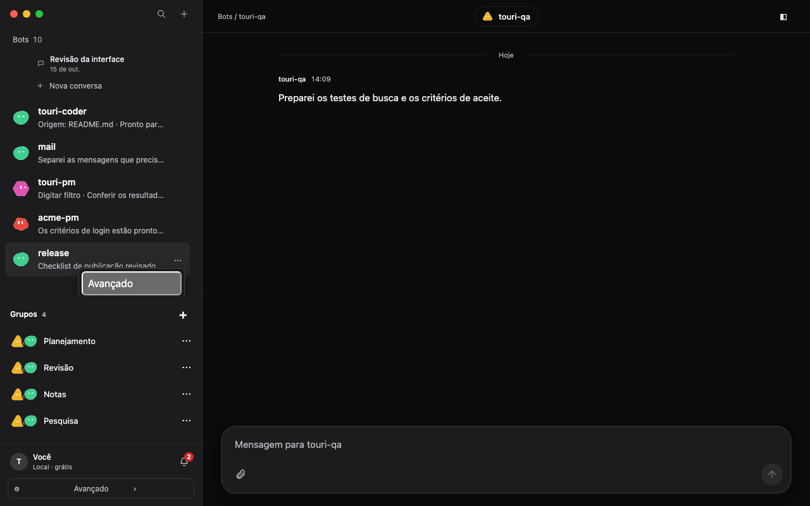
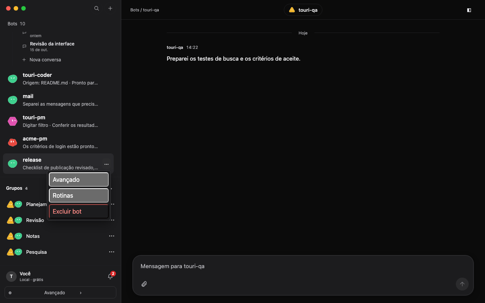
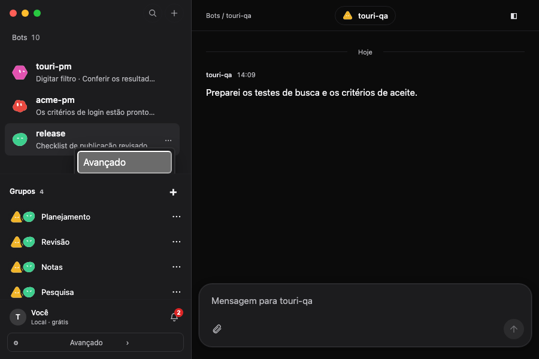
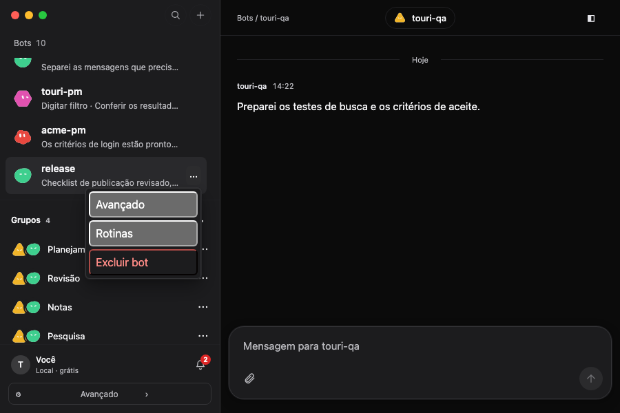

# Bot action menu clipping

Issue: #191. VISION promises 7 (Calm, clear, native) and 4 (The user is in charge).

The installed desktop app reproduced the original failure: Delete bot remained in the accessibility tree while the Groups section covered it. Escape returned focus to the actions trigger. No user data was changed during that check.

The screenshots below use synthetic workspace data in the running local UI. Before captures use the original menu implementation; after captures use this patch. Each bot is scrolled to the bottom of its list, next to Groups.

| Window | Before | After |
| --- | --- | --- |
| 1280 × 800 |  |  |
| 900 × 600 |  |  |

The bot menu and project selector now portal outside scrolling containers, flip when the preferred side lacks room, and shift inside the viewport. Menus opened in a native modal drawer remain in that top layer. Pointer activation preserves focus until the selected action runs.

On the original implementation, only 32.6% of the bot menu intersected the visible list area. The project selector was also clipped (57.5% at 1280 × 800 and 62.3% at 900 × 600). All four browser cases failed before the fix. Five unit regressions also failed with the original implementation.

The regression checks cover all bot actions, pointer hit testing, trigger toggling, arrow wrapping, Home/End, Escape, focus return after canceling a confirmation, viewport resizing, ancestor scrolling, and the mobile drawer. The sidebar Advanced navigation, notification center, group editor, and chat project selector are checked at both desktop sizes. Group mention suggestions render inline; model/settings pickers already use the shared modal layer.

## Validation

- Frozen dependency installation completed in this worktree.
- Static checks and type checking passed. Static checks report one existing unused-parameter warning outside this change.
- Browser regression suite: **10 tests passed** across both rendering engines.
- UI production build passed.
- Complete UI suite: **121 files, 1363 tests passed**.
- Complete baseline UI suite at `86d847d`: **120 files, 1357 tests passed**.
- An initial UI run hit a transient failure in `bot-settings-a11y.test.tsx`; its isolated baseline run and both complete runs above passed.

## Run locally

```sh
bun install --frozen-lockfile
bunx biome check .
bun run typecheck
(cd ui && NODE_OPTIONS=--no-experimental-webstorage bunx vitest run --maxWorkers=2)
(cd ui && bunx playwright test -c playwright.dialogs.config.ts bot-menu-clipping.spec.ts --workers=1)
bun --cwd ui build
```

The browser config tests both rendering engines, including the engine used by the desktop app. UI fixtures do not exercise a rebuilt installed app or live bot execution. No sidecar behavior changed.
