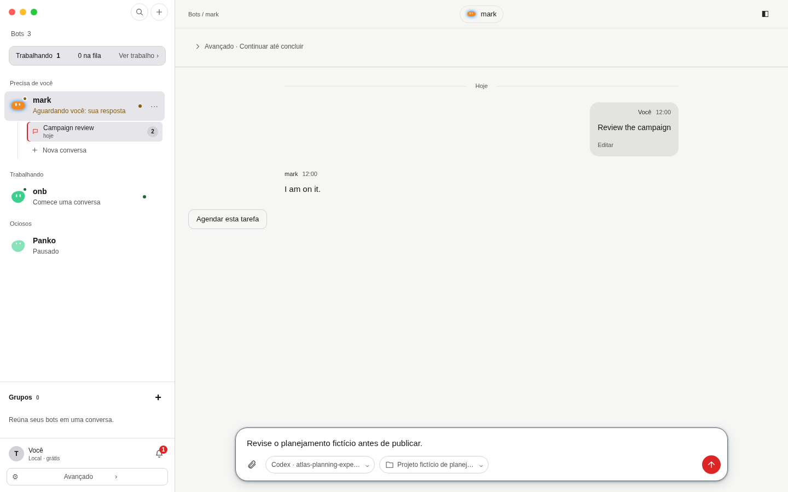
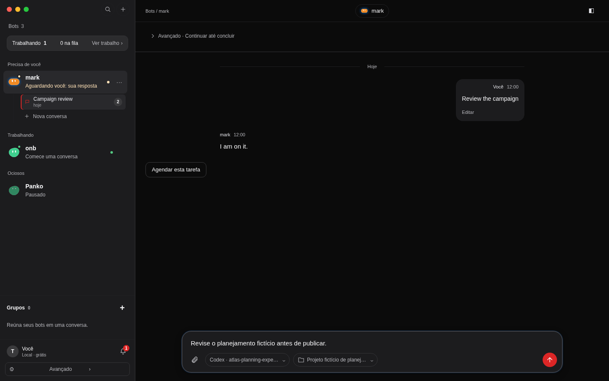
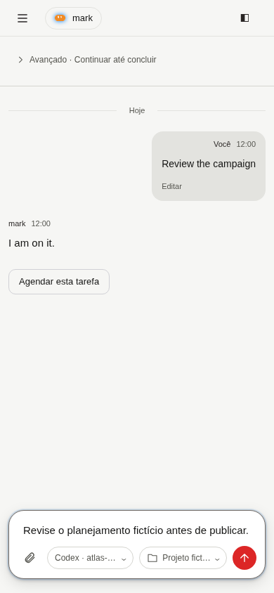
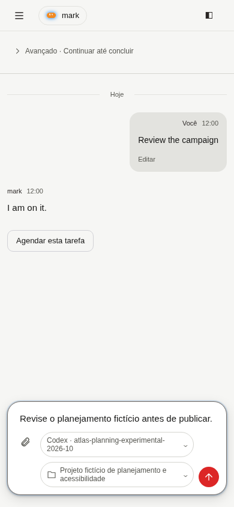
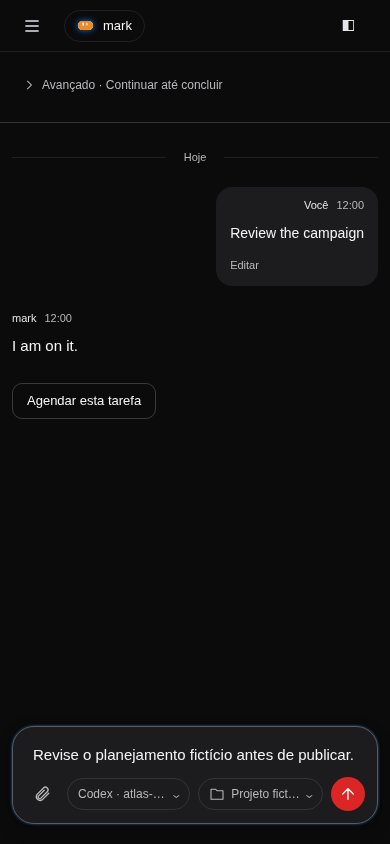
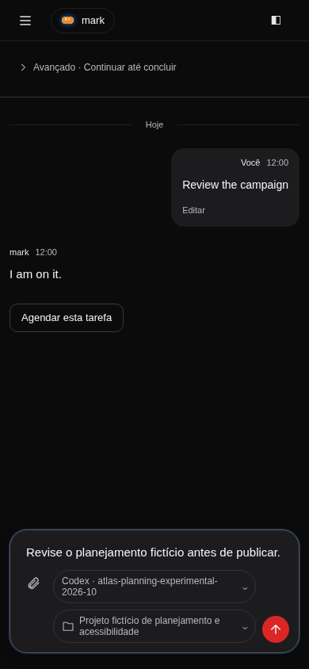

# Issue 430: visual evidence

At 390 px the selected provider/model and project wrap in their chips. The Send action has its own reserved space. Desktop styling is preserved.

All screenshots use the running React app with `createMockApi`, synthetic conversations and a synthetic draft. No production account, user database, microphone audio or personal filesystem content was loaded. The fixed clock is 2026-10-18 12:00 UTC.

Baseline: `2aaf77cb`. Desktop: 1440 × 900. Phone: 390 × 844. Both light and dark themes. Files named `before-*` show the baseline; `after-*` show this branch. The JSON files record viewport overflow and selected-label layout.

Open `/test/e2e/home-harness.html?scenario=long-composer` to reproduce the synthetic long labels. The same harness-only fixture was used against baseline CSS for the before captures.

| View | Before | After |
| --- | --- | --- |
| 1440 px, light |  |  |
| 1440 px, dark |  |  |
| 390 px, light |  |  |
| 390 px, dark |  |  |
