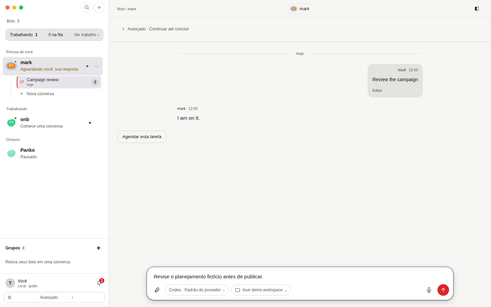
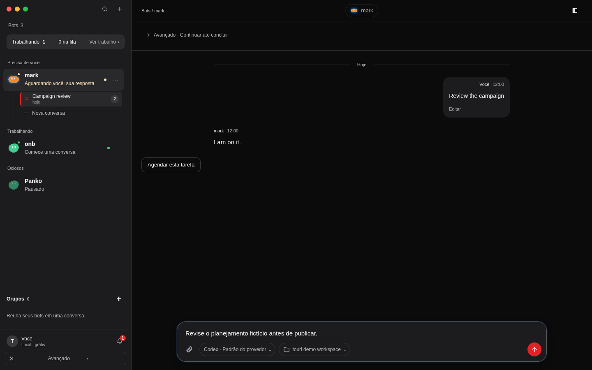
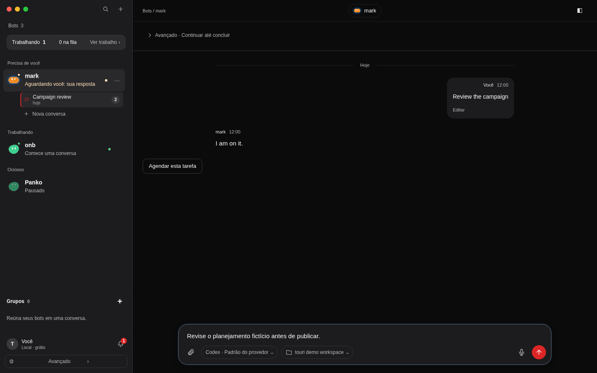
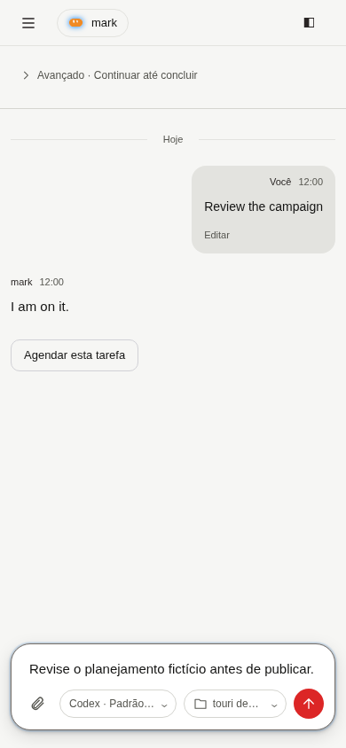
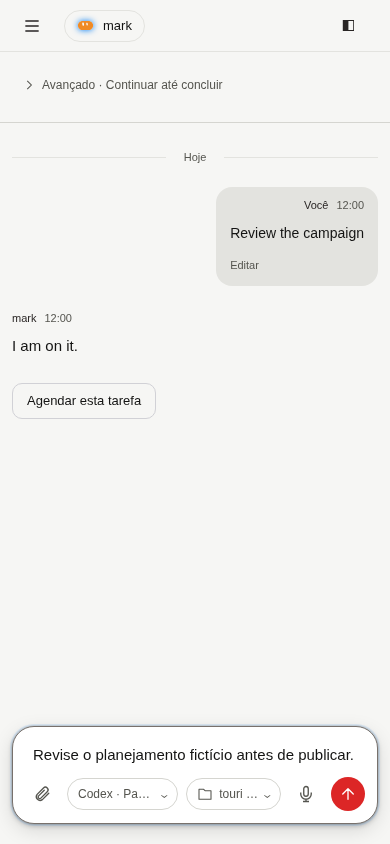
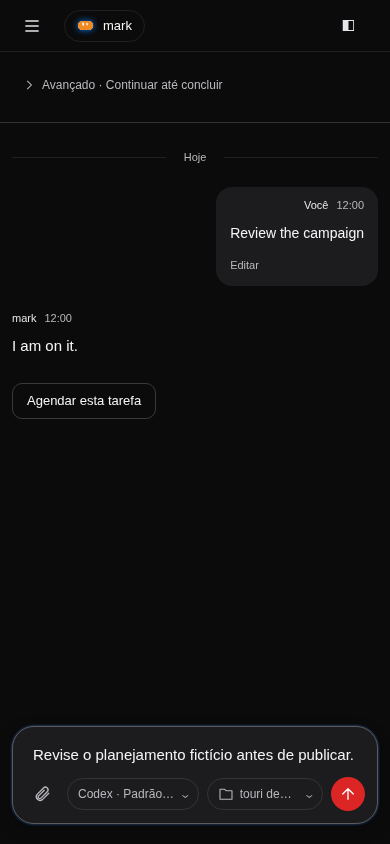
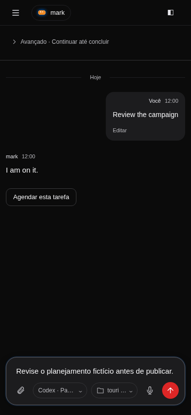

# Issue 431: visual evidence

The microphone action opens an informed-consent dialog. Only Start dictation creates a Web Speech session. Recording exposes Stop; recognized text stays in the draft for explicit review and Send.

All screenshots use the running React app with `createMockApi`, synthetic conversations and a synthetic draft. No production account, user database, microphone audio or personal filesystem content was loaded. The fixed clock is 2026-10-18 12:00 UTC.

Baseline: `2aaf77cb`. Desktop: 1440 × 900. Phone: 390 × 844. Both light and dark themes. Files named `before-*` show the baseline; `after-*` show this branch. The JSON files record viewport overflow and selected-label layout.

Open `/test/e2e/home-harness.html` to reproduce the mock app.

Speech is simulated with an injected browser constructor for repeatable evidence without microphone access or remote audio. `consent-*` shows the disclosure before microphone permission, and `recording-*` shows the recording/stop state. Granting and denying macOS microphone permission were not tested on real hardware. Vendor speech services were not exercised. The app defaults to pt-BR, like the existing translation helper; recognition receives the composer's `Locale` directly (`pt-BR` or `en`). Every new session requires fresh consent.

The four consent images were refreshed with the explicit browser-vendor cloud disclosure. Other images retain the original fixed-clock capture described above. To reproduce the refreshed images, run `bunx playwright test test/e2e/voice-input.spec.ts`; the disclosure check records both viewport sizes in light and dark themes using only synthetic app data.

| View | Before | After |
| --- | --- | --- |
| 1440 px, light |  |  |
| 1440 px, dark |  |  |
| 390 px, light |  |  |
| 390 px, dark |  |  |
