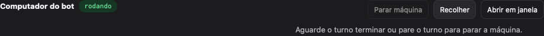
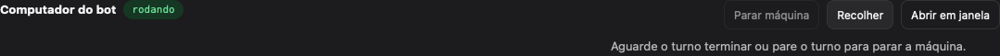
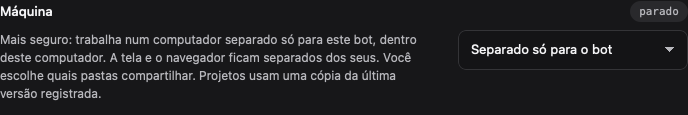
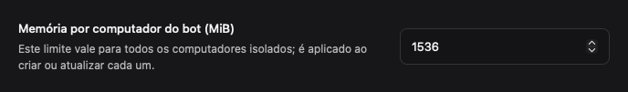
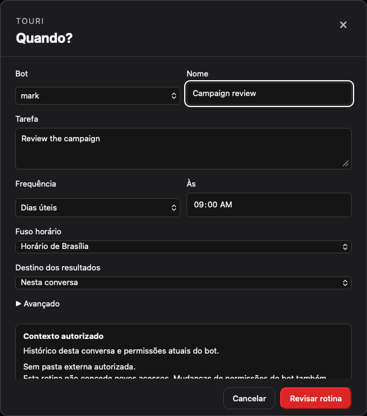

# Native QA round 6: computer settings and task actions

Issue: #194. Serves VISION promises 4 (user control), 6 (isolation by choice), and 7 (clear, native UI).

The running UI uses synthetic workspace data and a deterministic computer-screen fixture. The expanded-header regression failed on the original layout at 960 px because header items overlapped. The new copy and action regressions also failed before the fix.

The header now wraps its identity and controls without overlap. Its active-task explanation gets its own row. Machine choices describe where work happens and which screen and folders the bot can reach. Diagnostics, display details and memory settings sit behind a closed technical-details disclosure. Invalid memory settings reopen that disclosure so the value can be corrected.

Scheduling is labelled **Agendar esta tarefa**. Failed work offers **Tentar de novo**; recorded actions retain review and resume safeguards.

| Evidence | Screenshot |
| --- | --- |
| Active computer header, 960 px |  |
| Active computer header, 1280 px |  |
| Active computer header, 1440 px |  |
| Machine choice and consequence-first help |  |
| Memory after opening technical details |  |
| Scheduling action |  |
| Immediate retry action |  |
| Scheduling editor |  |

## Reproduce

```sh
bun install --frozen-lockfile
bunx biome check .
bun run typecheck
(cd ui && NODE_OPTIONS=--no-experimental-webstorage bunx vitest run --maxWorkers=2)
(cd ui && bunx playwright test -c playwright.native-r6.config.ts --workers=1)
TOURI_BROWSER_HEADLESS=1 bun test sidecar/test/runtime
TOURI_VM_INTEGRATION=0 TOURI_BROWSER_HEADLESS=1 bun test sidecar/test/vm
bun --cwd ui build
```

## Validation

- Frozen dependency installation completed in this worktree.
- Static and type checks passed. Static checks retain one existing unused-parameter warning outside this change.
- Full UI suite: **122 files, 1,368 tests passed**.
- Browser regressions: **18 tests passed** in both browser engines, including the desktop engine. Header geometry is checked at 960, 1280 and 1440 px; scheduling also runs at 390 px.
- Production UI build passed, with the existing large-chunk warning.

Sidecar comparisons used a separate clean worktree at `origin/main` (`21fd9c8`) with its own frozen dependency installation. No sidecar or contract files changed.

| Suite | This branch | Baseline comparison |
| --- | --- | --- |
| Runtime | 413 passed, 11 skipped, 1 failed | Full baseline: 414 passed, 11 skipped. The same orphan-process cleanup assertion also failed on a baseline repeat. |
| Machine, optional native integrations disabled | 385 passed, 18 skipped, 2 failed, 1 unhandled error | Baseline: 386 passed, 18 skipped, 1 different failure. Both cases that failed on this branch passed when isolated on both branches. |

The optional native batch was stopped after a closed-database timer error left connection cleanup stalled beyond its declared timeout. The same timer error was reproduced on the baseline. These unstable sidecar outcomes remain outside this UI change.
