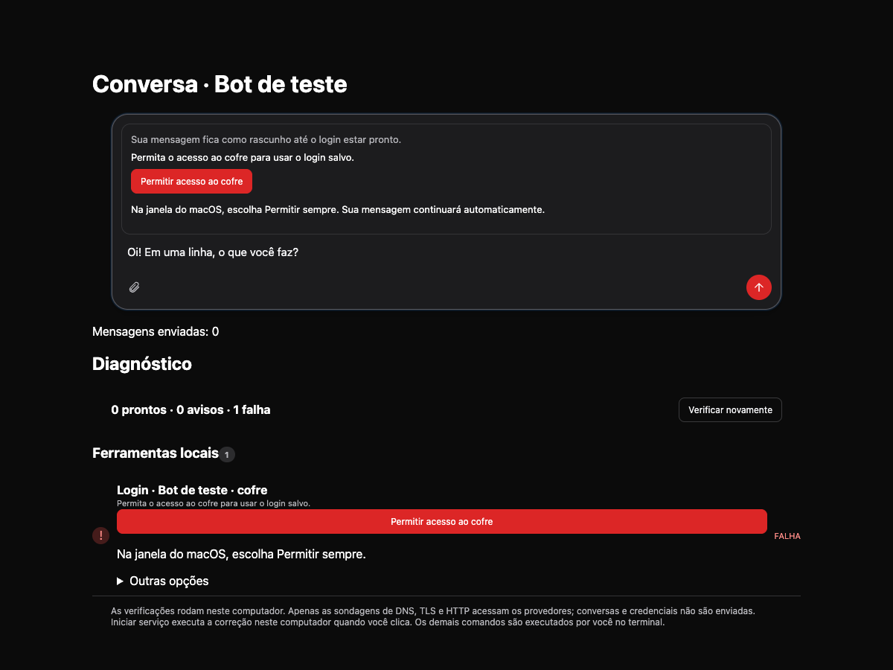
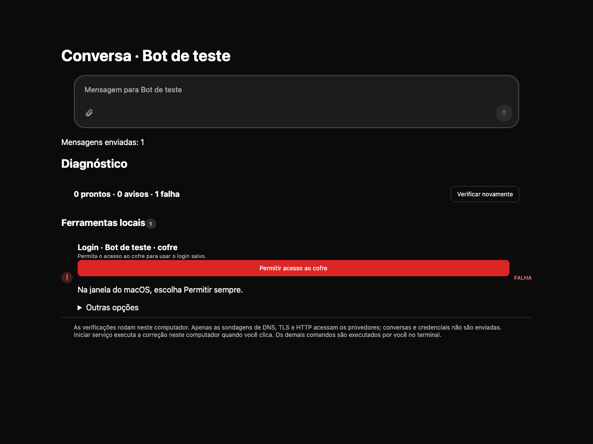
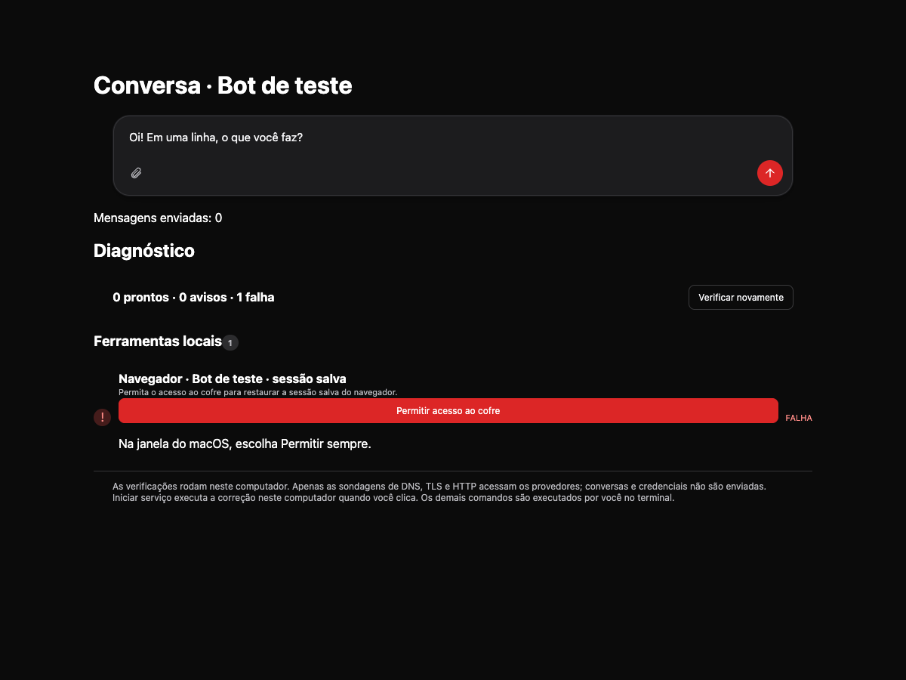
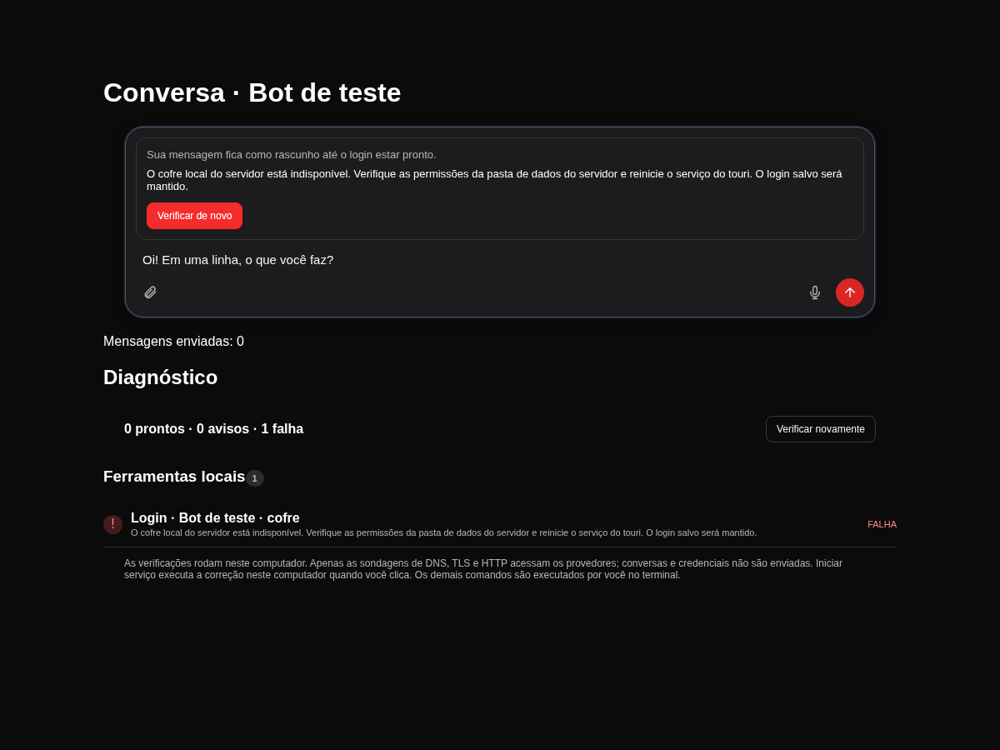

# Saved-login vault recovery

Issue: #148. Tests use only synthetic values in dedicated test services. Existing touri credentials and ACLs were not read, overwritten, or deleted.

The screenshots use the browser acceptance harness. It verifies a single action in chat and Doctor, a collapsed terminal alternative, and exactly one send of the preserved draft after a mocked native authorization succeeds. They are UI evidence; they do not claim system-dialog approval.

## Native macOS check

The native acceptance example uses the same `KeychainStore` implementation as the app:

| Check | Result |
| --- | --- |
| Ad-hoc build A writes a disposable item and reads it | Original synthetic value matches |
| Re-sign as build B with a different designated requirement; normal read | `VAULT_ACCESS_REQUIRED`, without waiting for system UI |
| Explicit authorization from the foreground test app | Native caller returns `VAULT_TIMEOUT` after 90 seconds without approval; requires a human to verify/approve the protected system dialog |
| Stable certificate: build A writes a separate disposable item | Success |
| Re-sign as build B with the same certificate and identifier | Designated requirement unchanged; original value reads without a new prompt |

**Pending acceptance:** a human must confirm the system authorization dialog is visible and select **Permitir sempre**, then verify the ad-hoc build B's normal read returns the original value. The automation cannot access the protected macOS authorization app. This protected system-dialog acceptance remains a manual check. No claim is made that the installed app's existing login has been repaired.

For an affected bot after installing the candidate build: attempt to send the message, click **Permitir acesso ao cofre**, and choose **Permitir sempre** in the macOS dialog (enter the login keychain password if requested). The attempted draft retries automatically. Doctor provides the same authorization action.

Native unit tests cover the deadline, bounded concurrency after timeout, typed denied/cancelled errors and a disposable item round trip. Sidecar tests cover error propagation, source preservation and Doctor/chat agreement. The new regression tests fail against the original main implementation.

## Checks

- `bun install --frozen-lockfile` completed in each worktree with its own dependencies.
- `bunx biome check .` and `bun run typecheck` pass. Biome retains one existing unused-parameter warning outside this change.
- UI: 1,197 tests pass across 104 files. The final run used two workers after concurrent native compilation caused unrelated five-second test timeouts. Browser acceptance: one test passes and captures the screenshots above.
- Sidecar, with live VM integration disabled: VM 364 pass / 18 skip; Doctor 35 pass; kernel 165 pass; projects 75 pass. Total 639 pass / 18 skip / zero failures. Matching main worktree: 631 pass / 18 skip / zero failures. The eight added tests account for the difference. The separate login/runtime regression run passes all 160 tests.
- `cargo test`: 82 tests pass (70 library, 12 integration). `cargo clippy --all-targets -- -D warnings` reports the same two existing `cloned_ref_to_slice_refs` findings in `file_grants.rs` on main and the branch.
- `bun --cwd ui build`, sidecar compilation and `bunx tauri build --bundles app` pass. The candidate app is built without replacing the installed app.
- Regression proof against main: the three new sidecar authorization checks and the UI preserved-draft authorization check fail without the implementation.
- Signing script syntax and the missing-identity failure path pass; the script stops before building when no matching identity exists.
- Both dedicated Keychain items were removed and verified absent. Disposable test apps and identified abandoned VM resources were cleaned up. No stable identity or user vault item was deleted or changed.

## Review follow-up (2026-10-17)

The review found that a denied browser-session key read could become an empty session and a later unencrypted save. Session reads now raise a typed error within four seconds. Saving requires a confirmed encryption key and verifies any existing ciphertext before replacing it; an absent, denied, invalid or replaced key leaves that file and its key untouched. New files never use `enc:none`. Legacy files remain readable and are upgraded to encryption only after successful vault access. The browser waits for the saved session to be readable before creating its context, so recovering access cannot later overwrite the saved cookies with an empty context.

Doctor now checks each saved browser session and offers foreground authorization for its own key on desktop macOS. Provider-login checks receive the actual platform/headless probes. Linux and headless hosts show server data-folder/restart guidance in Doctor and chat, without a native authorization action or a suggested replacement login. Chat keeps the draft while the server vault is unavailable. All new notices have Portuguese and English translations.

These screenshots use synthetic browser fixtures. Native authorization and existing user vault items were not exercised again in this follow-up; the protected system-dialog acceptance above remains manual.

Final checks after syncing with current `origin/main`:

| Check | PR | Main comparison |
| --- | --- | --- |
| Biome / typecheck | Pass; one existing unused-parameter warning | Same warning outside this change |
| UI unit tests | 1,212 pass / 105 files | No new failures |
| Browser UI acceptance | 3 pass: desktop draft recovery, server guidance, browser-session recovery | Synthetic fixtures |
| Sidecar Doctor | 39 pass / 0 fail | 35 pass / 0 fail |
| Sidecar browser | 129 pass / 1 fail | 119 pass / the same 1 fail |
| Sidecar VM | 366 pass / 18 skip / 0 fail | 360 pass / 18 skip / 0 fail |
| Sidecar projects | 75 pass / 0 fail | 75 pass / 0 fail |
| UI production build / compiled sidecar | Pass | No installed app replaced |

The one shared browser failure is `preview-e2e-local.test.ts`: its real local provider invocation fails before the MCP connection initializes (`closed_before_initialize`). All ten browser vault regressions pass. VM checks use `TOURI_VM_INTEGRATION=0`; browser checks use `TOURI_BROWSER_HEADLESS=1`. These are the relevant folders, not a claim that the entire sidecar suite passed.

Regression proof against the prior PR: the initial nine preservation checks failed before the session-vault fix; three server Doctor cases and three server chat cases failed before platform scoping. Restoring only the prior browser engine while retaining the new vault implementation also fails the new no-empty-context regression. After the fixes, the original encrypted cookies/storage are readable again following simulated authorization, and the preserved chat draft is sent exactly once. The existing deletion test now uses a working synthetic vault and asserts AES-256-GCM rather than depending on the removed unencrypted fallback.
